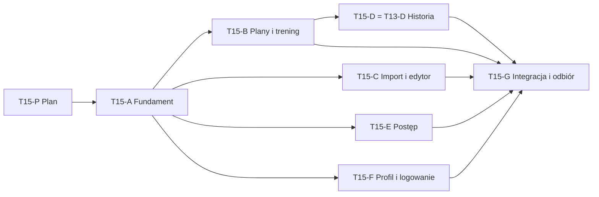

# T15 — plan wdrożenia wybranego UI

Aktualizacja: 2026-10-18. **Plan, nie wykonane wdrożenie.** T15-P przygotowuje dokumenty; A–G są niewykonane. Rozpoczęcie kodowania wymaga zlecenia użytkownika. Nie uruchomiono innych agentów. [Bieżące makiety](design/t14-selected-spec.md), [zasady współpracy](WORKFLOW.md), [decyzje](DECISIONS.md).

## Wybory i gotowość

Potwierdzone: Plany/Podgląd/Szczegóły A, Zapis serii C, Start A, Import C, Korekta A, Edytor A, Historia A, Profil A i Logowanie C. Postęp według szczegółowego briefu R4/R5: jeden układ dla ciężaru i masy ciała. Domyślna paleta **Noc**, także przy pierwszym wejściu bez preferencji systemowej. W makietach używa bursztynowego akcentu z wybranej palety, zamiast zieleni jasnego przykładu. Użytkownik nie zlecił kontowego przełącznika sześciu motywów; galeria palet pozostaje narzędziem projektowym.

Wybory wyglądu są kompletne. Można planować implementację bez następnej rundy A/B/C. Techniczne doprecyzowania należą do etapu odpowiedzialnego: kontrakty komponentów w A, ścisłe reguły agregacji i estymacji w E. Są opisanymi niżej propozycjami technicznymi, nie ukrytym nowym wymaganiem. Makiety nie dowodzą działania prawdziwych odczytów lub zapisu.

## Punkt startowy i zakres

Projekt ma działający Next.js/React/TypeScript oraz prywatne odczyty/zapis Supabase. **Nie budować aplikacji od nowa.** Lokalne T13-A/B/C są review po zaliczonych bramkach; ich komendy, datowanie, retry i ochrona szkiców pozostają. T13-D/E nadal niewykonane. Zmiany robocze są liczne i niewysłane: przed etapem wykonać manifest stanu, odczytać rzeczywiste handoffy i przejąć pliki, nie resetować checkoutu.

Pierwszy etap wdrożenia dotyczy kodu lokalnego i testów. Publikacja Vercel, zdalne migracje i fizyczny odbiór pozostają osobnymi czynnościami. Bez płatnego AI i zmiany parserów/dostawców w ramach redesignu. Ręczne formularze pozostają samodzielne. UI po polsku, identyfikatory po angielsku. Prywatny PDF i wyniki poza repo; testy na danych syntetycznych.

## Kolejność i właściciele

Najpierw A — wspólny fundament. Po przyjęciu jego bramki gotowe są B, C, E i F, ponieważ ich ścieżki są odrębne. D zaczyna po B i używa przeglądu treningu, bez jego kopiowania. G następuje po przyjęciu bramek B–F. Domyślnie uruchamiane **kolejno** przez użytkownika; praca równoległa jest możliwością po jawnym zleceniu, nie automatycznym uruchomieniem.

Jeden integrator I odpowiada za README, ROADMAP, STATUS, DECISIONS, CHANGELOG, TESTING, PRODUCT, UX, ARCHITECTURE, DATA_MODEL, OPEN_QUESTIONS, tę specyfikację oraz `src/app/globals.css`, `layout.tsx`, AppShell i wspólne UI po A. Przy pracy sekwencyjnej wykonawca może pełnić I; przy równoległej wykonawcy przekazują mu propozycje wpisów w swoich handoffach. Każdy ma wyłączne prawo zapisu do przydzielonego zakresu i własnego handoffu. Wspólny plik przejmuje się jawnie po zwolnieniu; nie wystarczy, że jest wymieniony w dwóch promptach.

Każdy etap ma gotowy [prompt](prompts/T15-A.md) i kartę w `handoffs/planned/T15-*.md`. Karta jest szablonem, nigdy dowodem wykonania. Faktyczny handoff zapisuje się osobno po pracy z rzeczywistą datą. Zakończenie każdej pracy zawiera identyczny prompt w odpowiedzi i handoffie z rekomendowanym modelem/kosztem, zgodnie z AGENTS/WORKFLOW. Promptów nie wysyłamy samoczynnie do innych chatów.

## A — fundament, Noc, nawigacja i zasoby

- Właściciel planowany: wykonawca A + I; przypisanie rzeczywiste przy rozpoczęciu. Zależności: jawne zlecenie, istniejące handoffy i manifest zastanych zmian. Następne B/C/E/F dopiero po jego bramce.
- Pliki: `src/app/layout.tsx`, `globals.css`, `src/components/app-shell.tsx`; nowe `src/components/ui/`, `src/lib/ui/`, `public/fonts/`, `public/exercise-assets/`. `package.json`/lockfile wyłącznie I, gdy konieczne. Nie dotyka parserów i komend treningu.
- Wynik: semantyczne tokeny Nocy, lokalny Inter z OFL, bez błysku jasnego motywu, nawigacja/safe-area, wspólne przyciski/pola/dymek i dostępny komponent ilustracji. Zachować publiczny kontrakt AppShell (`children`, `section`) lub zapisać addytywny adapter. Style pozostałych etapów w lokalnych CSS Modules, bez dopisywania sprzecznych globalnych reguł.
- Ikony akcji to spójny zestaw wektorowy; ćwiczenia osobno z lokalnego `design/exercise-assets/` po weryfikacji manifestu, licencji i dokładnego dopasowania. CC BY-SA4.0 dla ilustracji nie staje się MIT. Nie rysować przypadkowych sylwetek i nie przypisywać grafiki innego wariantu; brak zasobu ma neutralny znacznik. Do odnotowania dalsze pozyskanie brakujących dokładnych ruchów, bez blokowania ich obsługi.
- Bramka: typy/testy/build, czytelność Nocy na reprezentatywnych istniejących ekranach, fokus/klawiatura, kontrast tekstu i akcji, safe-area/360/390/430px, brak zasłaniania pól. Dostawców nowych zależności sprawdzić w oficjalnej dokumentacji przed instalacją. [Prompt A](prompts/T15-A.md).

## B — Start, Plany, Podgląd, Szczegóły i Zapis

- Właściciel B; po A. Pliki `src/app/page.tsx`, `plany/page.tsx`, `plany/[id]/page.tsx`, `trening/[id]/page.tsx`; `plan-preview`, `exercise-summary`, `workout-*` i ich testy; `src/lib/workouts/presentation*`. Style w nowych modułach tego zakresu. Nie przejmuje API/repository/SQL lub edytora planu.
- Przenieść wybrany wygląd na aktualne funkcje T13-C, nie zastępować ich symulacją makiety. Swipe planów natywnym dotykiem i klawiaturą; całe karty otwierają właściwe szczegóły. Cel, intensywność/kg, przerwa oraz wykonanie pozostają odrębne. Zachować rundy superserii, opcjonalne/dodatkowe, poprzedni wynik, źródła i brak kg.
- Bramka: cztery pełne karty390×844,360/430px bez overflow, gest bez przypadkowego otwierania, fokus/klawiatura/pola44px, powrót ze szkicem. Regresje T13-C: niezmienny retry, GET po ACK,409, głos jako propozycja, zapis0/null, daty i historyczne cele. Testy komponentów + właściwe lokalne HTTP/Chrome, typy/build. [Prompt B](prompts/T15-B.md).

## C — Import, Korekta i Edytor całego ćwiczenia

- Właściciel C; po A. Pliki `src/app/plany/import/page.tsx`, `plany/edytor/page.tsx`; komponenty `import-*`, `review-*`, `compact-plan-editor`, `plan-editor`, `plan-edit-dialogs`, `plan-set-fields`, `exercise-name-picker`, `plan-voice` i dotknięte testy; własne CSS Modules. Bez API/parserów/modeli/DB.
- Import C z wyśrodkowanymi ikonami i ikoną ręcznego tworzenia. Korekta A rozdziela nazwy ćwiczeń/kolejność, parametry serii i zatwierdzenie. Edytor A otwiera pełny formularz całą kartą, bez osobnego przycisku. Nazwa/serie/powtórzenia/obciążenie/przerwa i parametry indywidualnych serii, bez zamiany czasu/dystansu na powtórzenia.
- Bramka: poprawki i anulowanie, różne serie/rampa/superserie/opcjonalne, niejasności źródła blokujące publikację, podgląd PDF/XLSX i wznowienie korekty, lokalny szkic ≠ opublikowana wersja, idempotentne zatwierdzenie i ochrona historii. Istniejące testy edytora/importu oraz właściwe lokalne HTTP/Chrome z mockiem AI, bez płatnych prób. [Prompt C](prompts/T15-C.md).

## D — Historia A, realizowana razem z T13-D

- Właściciel D; po A/B i przyjętych bramkach T13-A/C. To **ta sama praca co T13-D**, a nie drugi kalendarz. Pliki `src/app/historia/page.tsx`, nowe komponenty kalendarza i ich moduły/testy. Przepisów `src/lib/workouts/repository.ts` nie zmienia równolegle: potrzeba nowego odczytu trafia do I, który czasowo przypisuje plik D.
- Miesiąc poniedziałek–niedziela, Dzisiaj i zmiana miesiąca, wiele sesji dziennie z prawdziwą godziną lub „nieznana”, aktywne osobno Wznów, powrót do tego samego dnia/miesiąca. Otwiera wspólny przegląd B/C, używa projekcji daty/strefy T13-A.
- Bramka łączy pełne R14–R16 z `T13_MOBILE_WORKOUT.md` i wygląd T14: puste/wiele wpisów, północ/DST/rok przestępny, legacy, delete, korekta czasu i prywatność. Po pracy oba ID pozostają review do odbioru. [Prompt D](prompts/T15-D.md) zastępuje samodzielne użycie starszego promptu T13-D w tym programie.

## E — Postęp z rzeczywistych wyników

- Właściciel E; po A i przyjętym odczycie/datowaniu T13-A (już lokalnie istnieje). Pliki `src/app/postep/page.tsx`, `src/lib/progress/` i testy, nowe komponenty `src/components/progress/` oraz ich CSS Modules. Nie edytuje profilu/1RM/komend workout. E jest jedynym autorem progress/repository, I koordynuje ewentualny współdzielony kontrakt.
- Jeden punkt = jeden trening danego ćwiczenia i wariantu, wyłącznie z wykonanych serii. Każdy niesie `workoutId`, datę, rzeczywistą godzinę jeśli znana, metrykę i identyfikatory źródłowych serii. Potrzebne ID dodać do odczytu; obecny summary/repository ich wszystkich nie zwraca. Nie generować dat/godzin/serii ani punktów pośrednich. Dwie sesje tego samego dnia pozostają dwoma wynikami; tooltip umożliwia ich rozróżnienie. Linia jedynie łączy wpisy, brak nie staje się0. Status sesji jest jawny, bez nazywania legacy/abandoned ukończonymi; dokładny dobór statusów zapisać przed agregacją, zachowując istniejącą semantykę rzeczywistych wykonanych serii lub zgłaszając jej zmianę.
- Wykres/metryki/zakresy/PR zgodne z R4/R5: tylko tap punktu otwiera informację, klik poza nim zamyka; dostępny cel44px i klawiatura. Pomoc1RM, pinch dat oraz swipe PR. Dla masy ciała metryki powtórzeń. Dane/demo jednoznacznie rozdzielone. Punkty i rekordy aktualizują się po poprawce historii, bez zapisywanego duplikatu statystyk.
- **Ważna zmiana odczytu:** obecny `getProgress(from,to)` filtruje treningi przed agregacją. PR „Cała historia” nie mogą powstawać z tak przyciętych danych. Zapewnić pełny autoryzowany zakres dla rekordów i niezależne okno wykresu, prawdziwą paginację (również ponad500 wpisów) oraz kontrolę właściciela na serwerze.
- Propozycja metody: zachować jawną tabelę makiety1–10 powtórzeń z wersją algorytmu, bez cichej zamiany na Brzyckiego/Epleya. Przed kodowaniem agregacji zapisać kontrakt wejścia, współczynniki, granice, zaokrąglenie prezentacji, remis/datę rekordu i porównywalność obciążeń. Więcej powtórzeń, null, czas/dystans, asysta i niejasna podstawa hantli nie są estymowane. Nie kopiować demonstracyjnych liczb. To techniczna propozycja do zamknięcia przez E/I, nie odczytane wymaganie użytkownika. Rzeczywisty datowany1RM profilu i snapshoty są nietykalne.
- Objętość zachowuje zasady porównywalności T08. Nie łączyć wariantów/masy ciała/asysty/kg na hantel ani dodatków z nieznaną semantyką. Jeżeli potrzeba rozszerzenia danych, zgłosić I przed zmianą modelu; brak nie uprawnia do zgadywania.
- Bramka: niezależnie policzone serie i rekordy, remisy, kilka treningów dziennie, korekty,1–10 i poza zakresem, null/0, prywatność A/B/anon, cała historia mimo filtrów, spójne daty T13-A, duża historia. Testy domenowe/komponentów i lokalne API/Chrome, gesty360/390/430, typy/build. Zwykły klik myszy ma pokazać widoczną informację także po propagacji, drag jej nie otwiera, a kolejny klik działa — odrębnie od dotyku/klawiatury (regresja makiety R6). [Prompt E](prompts/T15-E.md).

## F — Profil A i Logowanie C

- Właściciel F; po A. Pliki `src/app/profil/page.tsx`, `logowanie/page.tsx`, `ustaw-haslo/page.tsx`, `src/components/one-rep-max-editor.tsx`, ich testy i własne moduły CSS. Akcje logowania i potwierdzania konta czytać/reużywać, bez zmiany kontraktów Auth lub usług.
- Ręczny rzeczywisty1RM z datą, historia i zaokrąglenie, jasne odróżnienie od szacunku w Postępie. Nie tworzy treningu ani nie przelicza historycznych celów. Logowanie C obejmuje błędy, ładowanie, fokus i działające istniejące ustawianie hasła/wylogowanie, nie tylko statyczny panel.
- Bramka: profil rzeczywisty/demo, ręczny zapis/brak maksimum, daty i zachowana historia, sesja/wygasłe logowanie/błędy bez ujawniania cudzych danych, klawiatura i autofill w Nocy,360/390/430, właściwe regresje lokalnego T04/Auth, typy/build. [Prompt F](prompts/T15-F.md).

## G — Integracja i niezależny odbiór, wraz z T13-E

- I integruje przekazane zmiany, rozwiązuje styki i wykonuje pełne testy dopiero po zakończeniu autorów. Recenzent G powinien być innym wykonawcą od autorów A–F. W tym zleceniu nie został uruchomiony.
- Własność G: nowy raport `docs/reports/` i własny handoff, ewentualny niezależny runner `scripts/test-t15-acceptance.mjs`. Nie poprawia potajemnie src; zgłasza defekty z właścicielem, I przydziela naprawę, G powtarza odpowiednie sprawdzenia.
- Odbiór całego przepływu: logowanie→ręczny/importowany plan→korekta→edycja→trening→historia→Postęp→profil. Pełne bramki T13-E i nowe UI bez podwójnego zaliczania tej samej kontroli. Rzeczywisty lokalny Auth/API/DB, izolacja A/B/anon, retry/konflikty, korekty historii,360/390/430 i cztery karty, klawiatura/fokus i gesty. Testy/typy/build sekwencyjnie, by nie wywołać wyścigu generowania `.next`.
- Raport rozdziela test komponentu/mock AI, prawdziwe lokalne API, CDP touch i fizyczny telefon/Safari. Ten ostatni pozostaje jawnym otwartym odbiorem, jeżeli niedostępny. Lokalny PASS nie oznacza migracji lub publikacji produkcji. Dopiero po G I zamyka odebrany zakres T13/T15 lub wskazuje poprawki. [Prompt G](prompts/T15-G.md).

## Co nadal wymaga działania

Do rozpoczęcia A wystarczy osobne zlecenie implementacji; nie trzeba kolejnego wyboru wyglądu. Przed E wykonawca/I muszą doprecyzować techniczną specyfikację obliczeń i odczytów opisaną powyżej. Pozostałe etapy mogą mieć gotowe bramki wcześniej. Ewentualną potrzebę nowej biblioteki, migracji lub zmiany wymagań zgłaszać jawnie, nie traktować tej specyfikacji jako blankietowej zgody na usługi/koszty.

Każdy prompt odsyła do bieżącego STATUS i rzeczywistych handoffów poprzedników. Nie zawiera wymyślonych dowodów przyszłych etapów ani dat ich ukończenia. Preferowane modele: Sol/medium dla A/D/F, Sol/high dla B/C/E/G. Powód: zachowanie złożonych niezmienników w B/C/E i niezależny odbiór wymagają więcej analizy; pozostałe mają węższy kontrakt. Nie ma potrzeby rutynowego używania Ultra.

## Kontrakt przekazania B → D (I, 2026-10-18)

Wspólnym przeglądem pozostaje istniejący `WorkoutEditor({loaded})` pod `/trening/[id]`, z aktualnymi komendami, szkicami i poprawką historycznych serii. D nie tworzy drugiego edytora/przeglądu. D linkuje do tej trasy z opcjonalnymi `historyMonth=YYYY-MM` i `historyDay=YYYY-MM-DD`. B obsługuje te parametry w stronie treningu i buduje wyłącznie lokalny link `/historia?month=...&day=...`; waliduje rzeczywiste daty i zgodność dnia z miesiącem. Brak/błędne parametry dają bezpieczny `/historia`. Nie przyjmujemy dowolnego returnUrl. Wewnętrzne przejścia serii zachowują parametry powrotu; ochrona niezapisanych zmian obowiązuje także na tym linku. D odtwarza wybór z month/day. To techniczne doprecyzowanie istniejącego wymogu powrotu, nie nowa funkcja produktu. Zmiany wspólnego przeglądu po oddaniu B wymagają I.

## Stan programu — 2026-10-19

Zbiorcze zlecenie A–G jest aktywne. A–F mają lokalne bramki przyjęte przez I; G jeszcze niewykonane. Rzeczywiste wyniki i nieudane próby: checkpoint STATE oraz handoffy etapów. T13-D odebrane lokalnie razem z D, bez drugiego kalendarza. Dotychczasowe wybory i wymagania pozostają bez zmian; lokalne PASS nie oznacza publikacji, telefonu/Safari ani końcowego niezależnego odbioru.
