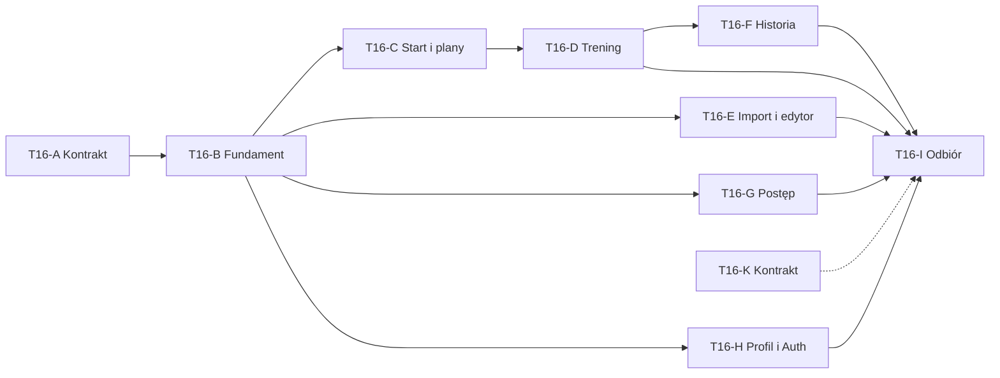

# T16 — wdrożenie interfejsu Tempo

Aktualizacja: 2026-10-19. Kontrakt programu dla kolejnych agentów. T16-A utrwala źródła i decyzję. Kod aplikacji nadal używa palety Nocy do czasu osobno zleconego T16-B. Ten dokument nie jest dowodem wdrożenia wyglądu.

## Źródła prawdy

Wygląd: [brief](tempo-implementation-brief.md) i [katalog klatek](tempo-frame-catalog.md). Oba pliki są wiernymi kopiami z Figma Make [UI-UX-Improvement-Suggestions](https://www.figma.com/make/D2nF5loZrbPDqY2oco8ske/UI-UX-Improvement-Suggestions), klucz `D2nF5loZrbPDqY2oco8ske`. SHA-1 po zapisie i ponownym odczycie MCP: brief `c6a5febd7dd57e4f4a6326d140e0c0a0e9ef6ee5`, katalog `654bc3f2c02c467c9414a49fc54d2ae8f3cf41f2`. Brief wewnątrz Make podaje punkt odniesienia `codex/t15-ui` przy `11d66bc`. Gałąź `codex/tempo` zawiera ten stan w merge commicie `70d66e6`.

Odczyt hierarchii i stanów: `src/App.tsx` w tym samym pliku Make. Identyfikatory stanów w prototypie pokrywają się z katalogiem. Prototyp służy do obejrzenia układu. Nie kopiować jego kodu, komponentów ani przykładowych liczb do aplikacji.

`public/references/tempo-extended/` w Make jest archiwum poprzedniej rundy. Nie jest wzorcem i nie trafia do repozytorium. Trzy klatki bazowe wymienione w briefie zostają w Make.

Zachowanie produktu: [T13](T13_MOBILE_WORKOUT.md), [T15](T15_UI_IMPLEMENTATION.md), [kontrakt Postępu](T15_PROGRESS_CONTRACT.md), D046. D047 zastępuje wyłącznie wizualną część D044 dotyczącą palety Noc. Starsze zdania o Nocy w PRODUCT, specyfikacji T15 i makietach T14 opisują odebrany lokalnie T15. Nie oznaczają drugiego motywu do utrzymania obok Tempo.

Na `70d66e6` kod ma `data-theme="night"` i `themeColor` `#11181f` w `src/app/layout.tsx` oraz tokeny Nocy w `src/app/globals.css`. T16-A tych plików nie zmienia.

## Zasady programu

Program ma ID T16 i etapy A, B, C, D, E, F, G, H oraz I. Rezerwowe T16-K „kontrakt” nie należy do zwykłej sekwencji.

Użytkownik uruchamia jednego agenta na jeden etap, wkleja prompt i czeka na handoff oraz lokalną bramkę. Następny etap startuje dopiero wtedy. Nie uruchamiać równoległego budowania całej listy: odbiór, ekrany i fundament zapisywałyby te same dokumenty stanu, zanim tokeny i decyzja są gotowe w kodzie.

Kolejność domyślna: A, B, C, D, E, F, G, H, I.

Twarde zależności:

- A przed B;
- B przed każdym ekranem C–H;
- C przed D, bo test C uruchamia runner treningu D;
- D przed F, bo test F klika interfejs treningu D;
- I na końcu i jako inny agent niż autorzy B–H.

Po odebranym B można uruchomić równolegle wyłącznie E, G i H. Warunki: trzy osobne agenty, jeden integrator edytujący ROADMAP, STATUS, CHANGELOG i TESTING, oraz zakaz edycji `globals.css`, AppShell i `src/components/ui/*` przez wykonawców ekranów. C, D, F i I zostają sekwencyjne. T16-K nigdy nie startuje razem z etapem wizualnym.

W każdym etapie najpierw wpisać właściciela i `in_progress` w ROADMAP, na końcu `review` oraz rzeczywisty handoff. Wspólne dokumenty stanu edytuje właściciel etapu przy pracy sekwencyjnej. Przy równoległych E/G/H edytuje je tylko integrator; wykonawcy proponują wpisy w handoffach.

Każdy etap: bez commitów, push, PR, publikacji, zdalnych migracji i płatnego AI. Bez zmian API, bazy, migracji, parserów, analityki, pięciu tras nawigacji i kontraktów Auth, poza zakresem osobno zatwierdzonego T16-K. Telefonu i Safari nie deklarować jako sprawdzonych. Testować na danych syntetycznych albo prawdziwym lokalnym Auth/API tam, gdzie etap to wskazuje. Liczby z klatek nie trafiają do aplikacji. `null` zostaje brakiem danych; zero i „Nie dotyczy” są osobnymi stanami.



K jest przerywane, bo startuje tylko po osobnej zgodzie. I nie zalicza stanu, którego odczyt nadal jest propozycją.

## Bramka luki kontraktu

Jeżeli stan z katalogu nie daje się wyrenderować z istniejącego autoryzowanego odczytu, wykonawca:

1. zatrzymuje wyłącznie ten fragment i nie upraszcza go przez zmianę API, schematu, parsera lub analityki;
2. zostawia brak brakiem: nie wstawia `null`, zera, tekstu ani wartości z makiety w miejsce pola, którego odczyt nie zawiera; prawdziwe `null` z odczytu pozostaje brakiem danych;
3. dodaje wyłączny dla swojego etapu plik `docs/proposals/T16-CONTRACT-<trasa>-<stan>.md` z brakującym polem lub semantyką, obecnym odczytem i jego ograniczeniem, najmniejszą proponowaną zmianą, wpływem na własność, RLS, idempotencję i kompatybilność, potrzebnymi testami oraz informacją, czy potrzebna jest migracja;
4. oznacza stan jako zablokowany kontraktem w handoffie i ROADMAP, a pozostałe niezależne stany kończy normalnie;
5. nie uruchamia T16-K i nie wdraża propozycji bez osobnej zgody użytkownika.

T16-I nie zalicza brakującego stanu. Może się rozpocząć po odebraniu zatwierdzonego T16-K albo po jawnej decyzji użytkownika o odłożeniu stanu, z zachowaniem otwartego kryterium. Każda migracja T16-K jest wyłącznie lokalna, dopóki użytkownik osobno i jednoznacznie nie zezwoli na zastosowanie jej poza maszyną deweloperską.

## Macierz klatek

Każdy stan ma klatkę `tempo / trasa / stan / mobile` (390 px) i `tempo / trasa / stan / desktop` (istniejący sidebar). Nazwanych stanów jest 85, więc klatek jest 170. Poniższa tabela przypisuje je etapom. Wiersz dyktowania w edytorze powtarza te same pięć identyfikatorów co dyktowanie treningu i nie zwiększa liczby 85. I sprawdza wszystkie. K nie ma własnych klatek.

| Trasa | Stany | Etap |
|---|---|---|
| `system` | `library`, `dialog-open` | B |
| `/` | `active-plan`, `resume-session`, `no-plan`, `many-plans`, `archived-version`, `read-error`, `demo-data`, `active-conflict-one`, `active-conflict-many`, `active-conflict-delete` | C |
| `/plany` | `selected-plan`, `empty-library` | C |
| `/plany/[id]` | `current-version`, `archived-version` | C |
| `/trening/[id]` przegląd | `in-progress`, `finished-readonly` | D |
| `/trening/[id]` seria | `previous-result`, `no-previous`, `load-missing`, `load-not-applicable`, `load-zero`, `rpe-rir-comment`, `time-distance`, `saving`, `network-error`, `conflict`, `unsaved-dialog`, `optional-choice` | D |
| dyktowanie na `/trening/[id]` | `recording`, `stopped`, `permission-denied`, `proposal`, `manual-correction` | D |
| zakończenie `/trening/[id]` | `summary-time`, `dst-choice`, `delete-session` | D |
| `/plany/import` | `empty-history`, `filled-history`, `uploading`, `processing`, `error-retry`, `cancelling`, `committed` | E |
| `/plany/import?id=[id]` | `names`, `series-supersets`, `summary`, `blocking-question`, `question-dialog`, `source-pdf`, `source-xlsx`, `edit-name`, `edit-block`, `edit-single` | E |
| `/plany/edytor` | `exercise-list`, `edit-exercise`, `edit-series-block`, `edit-single-series`, `edit-workout-order`, `delete-confirmation`, `validation-error` | E |
| dyktowanie w edytorze | te same identyfikatory głosu, tylko prezentacja `voice-input.tsx` | E |
| `/historia` | `selected-day`, `empty-day`, `unknown-time` | F |
| `/postep` | `populated`, `empty`, `single-point`, `gap`, `selected-point`, `no-change`, `estimated-vs-real` | G |
| `/profil` | `account-history`, `empty-history`, `demo-account`, `help` | H |
| `/logowanie` | `empty`, `field-error`, `expired`, `signed-out`, `demo-environment` | H |
| `/ustaw-haslo` | `empty`, `too-short`, `save-error`, `submitting` | H |

Konflikt jednej sesji: główne `Wróć do treningu`, drugorzędne `Zakończ i rozpocznij nowy`, osobne niebezpieczne `Usuń i rozpocznij nowy` z własnym potwierdzeniem. Kilka sesji ma ten zestaw osobno, bez scalania. D046: karta może wejść pod nawigację i musi być doskrolowalna. Hasło ma jedno pole nowego hasła.

## A — kontrakt Tempo

- Status: review (2026-10-19). Właściciel: Cursor agent, sesja T16-A. Zależności T15/T13 i decyzja o Tempo spełnione. Pliki zwolnione.
- Wynik: wierne kopie briefu i katalogu, D047, ten dokument, aktualizacja DESIGN, UX, ROADMAP, STATUS, CHANGELOG, README i [handoff](handoffs/2026-10-19-T16-A-kontrakt-tempo.md).
- Odbiór: ponowny odczyt MCP obu dokumentów, zgodność SHA-1, identyfikatory stanów z `App.tsx`, linki i `git diff --check`. Bez testów produktu i bez zmian `src/`.

## B — fundament Tempo

- Właściciel: nieprzejęty. Zależność: T16-A w review i osobne zlecenie. Następne ekrany dopiero po bramce B.
- Wyłączna edycja: `src/app/globals.css`, `src/app/layout.tsx`, `src/components/app-shell.tsx`, `src/components/ui/*`, prezentacyjne `src/lib/ui/*`, `src/components/ui/ui.test.tsx`, `scripts/test-t15a-browser.mjs`, ROADMAP, STATUS, CHANGELOG, TESTING, `docs/handoffs/2026-10-19-T16-B-fundament-tempo.md`.
- Odczyt: dokumenty T16/Tempo, strony i moduły ekranowe, `public/fonts/*`, `public/exercise-assets/*`, konfiguracja Supabase.
- Odbiór: `--tempo-*` mapują istniejące aliasy w jednym `:root`. Brak `data-theme="night"`, przełącznika i równoległej palety. `themeColor` równe `#11191c`. Inter pozostaje lokalny. Button, Field, ListRow, Card, StatusBadge, SegmentedControl, Notice, EmptyState, Dialog oraz mobilny BottomNav i desktopowy Sidebar mają spójne warianty, fokus, 44×44 i reduced motion. Pięć tras bez zmian. AppShell zachowuje stan prywatny, demo i safe-area.
- Testy: testy UI, lokalny Chrome `test-t15a-browser.mjs` dla 360/390/430 i desktop, kontrast AA, klawiatura, skip-link i fokus, `npm test`, `npm run build`, potem `npm run typecheck`.
- Zakazy: stylowanie ekranów biznesowych, nowe ilustracje, zbędne zależności, API i baza.

Prompt startowy:

```text
Projekt: /Users/jakub.olech/GIT/apka-plan-treningowy, gałąź codex/tempo. Wykonaj tylko T16-B z docs/T16_TEMPO_IMPLEMENTATION.md. Najpierw przeczytaj AGENTS.md, README.md, docs/STATUS.md, docs/ROADMAP.md, docs/handoffs/2026-10-19-T16-A-kontrakt-tempo.md, docs/tempo-implementation-brief.md, docs/tempo-frame-catalog.md oraz D046 i D047 w docs/DECISIONS.md. Sprawdź git status; kod bazowy to 70d66e6, a kontrakt T16-A może być jeszcze niezacommitowany. Przez Figma MCP obejrzyj Make D2nF5loZrbPDqY2oco8ske, src/App.tsx: komponenty system/library i AppShell mobile/desktop. Edytuj wyłącznie src/app/globals.css, src/app/layout.tsx, src/components/app-shell.tsx, src/components/ui/*, prezentacyjne src/lib/ui/*, src/components/ui/ui.test.tsx, scripts/test-t15a-browser.mjs, docs/ROADMAP.md, docs/STATUS.md, docs/CHANGELOG.md, docs/TESTING.md i nowy docs/handoffs/2026-10-19-T16-B-fundament-tempo.md. Zbuduj jeden system Tempo: --tempo-* mapują istniejące aliasy w jednym :root; usuń data-theme="night" i nie dodawaj przełącznika ani drugiej palety; themeColor ustaw na #11191c. Zachowaj pięć tras, lokalny Inter, safe-area, fokus, cele 44×44 i prefers-reduced-motion. Nie przebudowuj ekranów C–H, API, bazy ani nowych ilustracji. Jeśli komponent wymaga danych nieobecnych w autoryzowanym odczycie, zatrzymaj ten fragment i zapisz docs/proposals/T16-CONTRACT-<trasa>-<stan>.md; nie wdrażaj propozycji i nie podstawiaj danych z makiety. Uruchom testy UI, lokalny Chrome 360/390/430 i desktop, npm test, npm run build, potem sekwencyjny npm run typecheck. Zaktualizuj dokumenty stanu i testów, utwórz handoff oraz prompt kolejnego etapu. Nie commituj, nie pushuj, nie twórz PR i nie przechodź do T16-C.
```

Rekomendacja dla B: GPT-5.6 Sol, medium. Fundament jest szeroki, a domena zostaje bez zmian, więc medium jest wystarczające i tańsze niż high.

## C — start, plany i podgląd

- Właściciel: nieprzejęty. Zależność: odebrany B.
- Wyłączna edycja: `src/app/page.tsx`, `src/app/plany/page.tsx`, `src/app/plany/[id]/page.tsx`, `src/components/plan-carousel*`, `src/components/plan-preview*`, `src/components/exercise-summary*`, `src/components/training-preview*`, `src/components/workout-start.tsx`, `src/components/workout-start.test.tsx`, `src/components/plan-workout.module.css`, `scripts/test-t15b-browser.mjs`, dokumenty stanu/testów i `docs/handoffs/2026-10-19-T16-C-start-plany.md`.
- Odczyt: `src/lib/plans/*`, `src/lib/workouts/*`, trasy API, `workout-command.ts`, fundament B, T13/T15/Tempo.
- Odbiór: jedna dominująca akcja. Karuzela ma dotyk, mysz, klawiaturę i wskaźnik. Archiwum nie startuje. Brak planu i błąd odczytu są różnymi stanami. Podgląd zachowuje serie, rampy, superserie, opcjonalność, źródła, `null` i 0. Konflikt pokazuje osobne zestawy akcji z briefu. D046: doskrolowanie, brak poziomego overflow.
- Testy: karuzela, podgląd i start, `test-t15b-browser.mjs` z regresją T13-C, 360/390/430 i desktop, gesty i fokus, typy i build. Oczekiwania danych bez zmian.
- Zakazy: API, repozytoria, SQL, fałszywe plany, wymóg czterech kart kończących się nad nawigacją.

Prompt startowy:

```text
Projekt: /Users/jakub.olech/GIT/apka-plan-treningowy. Wykonaj tylko T16-C. Przeczytaj AGENTS.md, README.md, STATUS, ROADMAP, handoff T16-B, docs/T16_TEMPO_IMPLEMENTATION.md, brief i katalog Tempo oraz T13_MOBILE_WORKOUT. Przez Figma MCP obejrzyj App.tsx: HomeContent, PlansContent i PlanContent, zwłaszcza active-conflict-one, active-conflict-many i active-conflict-delete. Edytuj wyłącznie strony start/plany/podgląd, plan-carousel, plan-preview, exercise-summary, training-preview, workout-start, ich testy i moduły stylów wskazane w tej specyfikacji. Zachowaj prawdziwe odczyty i komendy. Powrót z aktywnego treningu jest primary, zakończenie secondary, usunięcie osobnym danger i dialogiem. D046 obowiązuje: sprawdzaj doskrolowanie. Gdy istniejący odczyt nie zawiera danych dla stanu, zatrzymaj ten stan, dodaj docs/proposals/T16-CONTRACT-*.md i nie edytuj API, repozytorium ani SQL. Uruchom testy komponentów, test-t15b-browser z regresją T13-C, 360/390/430 i desktop, build oraz typecheck. Utwórz handoff i prompt kolejnego etapu. Bez commitów i bez etapu D. Model rekomendowany: GPT-5.6 Sol, high — etap styka się z konfliktami i istniejącymi komendami.
```

## D — trening

- Właściciel: nieprzejęty. Zależność: odebrany C.
- Wyłączna edycja: `src/app/trening/[id]/page.tsx`, `src/components/workout-editor*`, `src/components/workout-voice*`, `src/components/workout-finish*`, `src/components/workout-dialog.tsx`, `src/components/workout-command-status.tsx`, `src/components/workout-editor.module.css`, `scripts/test-t13c-browser.mjs`, dokumenty stanu/testów i `docs/handoffs/2026-10-19-T16-D-trening.md`.
- Odczyt: `workout-command.ts`, `workout-state.ts`, `workout-fixture.ts`, `src/lib/workouts/*`, API, głosowa domena, T13/T15/Tempo.
- Odbiór: przegląd, jedna seria, dyktowanie, finish, DST, delete i readonly odpowiadają katalogowi. `null`, `0` i „Nie dotyczy” są trzema stanami. Czas i dystans nie stają się powtórzeniami. Opcjonalna seria nie zapisuje się przez samo otwarcie. Ręczna ścieżka działa bez AI. Pełny retry zachowuje identyczną komendę. ACK poprzedza aktualny GET. 409 zachowuje szkic. Nawigacja daje Zapisz, Odrzuć i Zostań. Finish nie zmienia snapshotów. Test D046 sprawdza doskrolowanie.
- Testy: workout-editor, voice i state, pełny lokalny `test-t13c-browser.mjs`, regresje T13-A, T05 i T09 bez płatnego AI, 360/390/430 i obniżony viewport klawiatury, `npm test`, build i typecheck.
- Zakazy: edycja komendy, API, kontraktów, bazy, modeli i promptów głosu oraz analityki.

Prompt startowy:

```text
Projekt: /Users/jakub.olech/GIT/apka-plan-treningowy. Wykonaj tylko T16-D. Przeczytaj AGENTS.md, README.md, handoff T16-C, T16 spec, brief, katalog, T13_MOBILE_WORKOUT i D046. Przez Figma MCP obejrzyj WorkoutContent, SetContent, VoiceContent i FinishContent. Edytuj tylko stronę /trening/[id], komponenty workout-editor, voice, finish, dialog i status, ich testy, CSS i test-t13c-browser.mjs. Nie edytuj workout-command.ts, workout-state.ts, API ani lib/workouts. Zachowaj identyczny retry, ACK i aktualny GET, 409, szkice, poprawkę czasu i snapshoty. Null, 0 i Nie dotyczy muszą pozostać różne. Gdy stan wymaga nieobecnego pola, zatrzymaj fragment i zapisz propozycję T16-CONTRACT. Zmień starą asercję czterech kart zgodnie z D046 na dostępność przez scroll, jeśli jeszcze jej nie ma. Uruchom pełną regresję T13-C oraz adekwatne T13-A, T05 i T09, npm test, build i typecheck. Utwórz handoff i prompt kolejnego etapu. Bez płatnego AI, commitów i etapu E. Model rekomendowany: GPT-5.6 Sol, high — krytyczny przepływ trwałości i szkiców.
```

## E — import, korekta i edytor

- Właściciel: nieprzejęty. Zależność: odebrany B. W sekwencji domyślnej po D. Równolegle tylko z G i H, na warunkach z sekcji zasad.
- Wyłączna edycja: `src/app/plany/import/page.tsx`, `src/app/plany/edytor/page.tsx`, `src/components/import-*`, `src/components/review-*`, `src/components/compact-plan-editor*`, `src/components/plan-editor*`, `src/components/plan-edit-dialogs.tsx`, `src/components/plan-set-fields.tsx`, `src/components/exercise-name-picker.tsx`, prezentacyjnie `src/components/voice-input.tsx`, `src/components/plan-authoring.module.css`, `scripts/test-t15c-*.mjs`, dokumenty stanu/testów i `docs/handoffs/2026-10-19-T16-E-import-edytor.md`.
- Odczyt: `src/lib/imports/*`, `src/lib/domain/*`, `src/lib/exercises/*`, trasy importu i API, storage, brief i katalog.
- Odbiór: import rozróżnia wszystkie statusy katalogu. Plik i zdjęcie dominują. Tekst, głos i ręczny edytor są wtórne. Korekta ma Nazwy, Serie i superserie, Podsumowanie oraz jedno pytanie. Źródło jest pełnoekranowe na telefonie i obok planu na desktopie. Nierozwiązane pytanie blokuje publikację. Edytor otwiera się całą kartą i zachowuje indywidualne serie, anulowanie, wersje, retry oraz brak autosave.
- Testy: komponenty importu i edytora, `test-t15c-http.mjs`, Chrome z mockiem AI i syntetycznym PDF/XLSX, 360/390/430 i desktop, `npm test`, build i typecheck.
- Zakazy: parsery, prompty, modele, limity, API, baza, nowe wywołania AI i liczby z prototypu.

Prompt startowy:

```text
Projekt: /Users/jakub.olech/GIT/apka-plan-treningowy. Wykonaj tylko T16-E. Przeczytaj AGENTS.md, README.md, T16 spec, handoff poprzedniego odebranego etapu, brief i katalog. Przez Figma MCP obejrzyj ImportContent, ReviewContent i EditorContent wraz ze stanami. Edytuj tylko strony importu i edytora, przypisane komponenty oraz testy i runnery T15-C. Zachowaj dokumenty planu, ID, pytania, źródła PDF/XLSX, trzy etapy, retry i idempotentne zatwierdzenie. Nie zmieniaj src/lib/imports, src/lib/domain, API, parserów, AI ani bazy. Jeżeli katalog wymaga pola niewystępującego w szkicu, zatrzymaj ten stan i zapisz T16-CONTRACT. Testuj mock AI i własne syntetyczne PDF/XLSX, bez płatnych prób. Wykonaj testy komponentów, T15-C HTTP i Chrome, 360/390/430 i desktop, npm test, build i typecheck. Utwórz handoff i prompt kolejnego etapu. Bez commitów i bez F. Model rekomendowany: GPT-5.6 Sol, high — szeroki formularz z wieloma niezmiennikami danych.
```

## F — historia

- Właściciel: nieprzejęty. Zależność: odebrany D.
- Wyłączna edycja: `src/app/historia/page.tsx`, `src/components/history/*`, `scripts/test-t15d-browser.mjs`, dokumenty stanu/testów i `docs/handoffs/2026-10-19-T16-F-historia.md`.
- Odczyt: `src/lib/workouts/calendar*`, `calendar-data.ts`, `time.ts`, repozytorium, API, T13 część D i Tempo.
- Odbiór: poniedziałek–niedziela, Dzisiaj, zmiana miesiąca, pusty dzień, wiele sesji, aktywne Wznów osobno, zakończone Otwórz trening, prawdziwa godzina albo „godzina nieznana”, powrót do miesiąca i dnia, 44 px i klawiatura. Projekcja czasu, DST i własność bez zmian.
- Testy: history-calendar, `test-t15d-browser.mjs` z prawdziwym lokalnym API, północ, DST, rok przestępny, delete, korekta, A/B/anon, 360/390/430 i desktop, `npm test`, build i typecheck.
- Zakazy: repozytorium, czas, API, baza i zmiana nawigacji.

Prompt startowy:

```text
Projekt: /Users/jakub.olech/GIT/apka-plan-treningowy. Wykonaj tylko T16-F. Przeczytaj AGENTS.md, README.md, T16 spec, handoff T16-E, brief, katalog i T13 część D. Przez Figma MCP obejrzyj HistoryContent: selected-day, empty-day i unknown-time. Edytuj wyłącznie stronę historii, src/components/history/*, ich testy i CSS oraz test-t15d-browser.mjs. Nie zmieniaj calendar, time, repository ani API. Zachowaj projekcję daty, DST, legacy „godzina nieznana”, aktywne Wznów i powrót do miesiąca oraz dnia. Brak pola w DTO dokumentuj jako T16-CONTRACT i zatrzymaj tylko zależny stan. Uruchom testy komponentu, pełny lokalny runner historii z A/B/anon, 360/390/430 i desktop, npm test, build i typecheck. Utwórz handoff i prompt kolejnego etapu. Bez commitów, publikacji i G. Model rekomendowany: GPT-5.6 Sol, medium — prezentacja na zamrożonym kontrakcie czasu.
```

## G — postęp

- Właściciel: nieprzejęty. Zależność: odebrany B. W sekwencji domyślnej po F. Równolegle tylko z E i H.
- Wyłączna edycja: `src/app/postep/page.tsx`, `src/components/progress/*`, `scripts/test-t15e-browser.mjs`, dokumenty stanu/testów i `docs/handoffs/2026-10-19-T16-G-postep.md`.
- Odczyt: cały `src/lib/progress/*`, [T15_PROGRESS_CONTRACT](T15_PROGRESS_CONTRACT.md), workout, time, repozytorium i API.
- Odbiór: ostatni wynik ponad wykresem. Stany empty, single, gap, selected, no-change oraz estimated-vs-real. Tylko punkt otwiera szczegół; klik poza nim zamyka. Lista alternatywna, klawiatura, pinch, zakresy i swipe rekordów. Rekordy obejmują całą historię. Brak danych pozostaje brakiem. Rzeczywiste 1RM zostaje w Profilu. Wyniki przed i po redesignie są identyczne dla tych samych fixtures.
- Testy: niezmienione testy analityki i repozytorium jako regresja, progress-dashboard, `test-t15e-api.mjs` bez edycji tego pliku, dostosowany browser runner, ponad 500 rekordów, A/B/anon, korekty, null i 0, mysz, dotyk, 360/390/430 i desktop, `npm test`, build i typecheck.
- Zakazy: edycja `lib/progress`, algorytmów, współczynników, paginacji, API i danych.

Prompt startowy:

```text
Projekt: /Users/jakub.olech/GIT/apka-plan-treningowy. Wykonaj tylko T16-G, warstwę UI Postępu. Przeczytaj AGENTS.md, README.md, T16 spec, handoff T16-F, brief, katalog i T15_PROGRESS_CONTRACT. Przez Figma MCP obejrzyj ProgressContent i wszystkie stany. Edytuj tylko stronę /postep, src/components/progress/* i test-t15e-browser.mjs. Cały src/lib/progress/* oraz test-t15e-api.mjs są tylko do odczytu. Zachowaj null i 0, pełną historię PR oraz rozdzielenie szacunku od rzeczywistego 1RM. Jeżeli UI wymaga niewystępującego pola lub innej agregacji, zatrzymaj ten stan i zapisz T16-CONTRACT. Uruchom analitykę i repozytorium jako regresję, API ponad 500 rekordów oraz A/B/anon, komponent i Chrome, 360/390/430 i desktop, npm test, build i typecheck. Utwórz handoff i prompt kolejnego etapu. Bez commitów i bez H. Model rekomendowany: GPT-5.6 Sol, high — wizualizacja ma zachować znaczenie danych.
```

## H — profil i auth

- Właściciel: nieprzejęty. Zależność: odebrany B. W sekwencji domyślnej po G. Równolegle tylko z E i G.
- Wyłączna edycja: `src/app/profil/page.tsx`, `src/app/logowanie/page.tsx`, `src/app/ustaw-haslo/page.tsx`, `src/components/one-rep-max-editor.tsx`, `src/components/one-rep-max-editor.test.tsx`, `src/components/account-form.tsx`, `src/components/account.module.css`, `scripts/test-t15f-browser.mjs`, dokumenty stanu/testów i `docs/handoffs/2026-10-19-T16-H-profil-auth.md`.
- Odczyt: `src/app/logowanie/actions.ts`, `src/app/ustaw-haslo/actions.ts`, API profilu i 1RM, repozytoria, konfiguracja Supabase.
- Odbiór: Profil zapisuje rzeczywiste datowane 1RM i pokazuje historię, pustkę oraz demo. Nie przelicza historii. Logowanie zachowuje autofill, generyczny błąd, expired, signed-out i demo. Ustawienie hasła ma dokładnie jedno pole `new-password`, widoczne minimum 12, zachowanie wartości po błędzie i blokadę duplikatu. Wylogowanie nie jest głównym CTA.
- Testy: one-rep-max i account, `test-t15f-browser.mjs` z login, error, focus, 1RM, step, password, logout i relogin, asercja jednego pola hasła i autofill, 360/390/430 i desktop, `npm test`, build i typecheck.
- Zakazy: akcje Auth, API, baza, polityki, ujawnianie istnienia konta i drugie pole hasła.

Prompt startowy:

```text
Projekt: /Users/jakub.olech/GIT/apka-plan-treningowy. Wykonaj tylko T16-H. Przeczytaj AGENTS.md, README.md, T16 spec, handoff T16-G, brief i katalog. Przez Figma MCP obejrzyj ProfileContent, LoginContent i PasswordContent. Edytuj tylko wskazane trzy strony, account-form, account.module.css, one-rep-max-editor z testami i test-t15f-browser.mjs. Actions Auth, API 1RM, repozytoria i Supabase są tylko do odczytu. Ustaw hasło ma dokładnie jedno pole nowego hasła z autocomplete=new-password i minimum 12. Zachowaj prywatny błąd logowania, expired, signed-out, demo, datowane rzeczywiste 1RM i niezmienność historii. Brakujące dane konta dokumentuj jako T16-CONTRACT. Uruchom testy komponentów i pełny lokalny Auth runner 360/390/430 i desktop, npm test, build i typecheck. Utwórz handoff i prompt kolejnego etapu. Bez commitów, publikacji i I. Model rekomendowany: GPT-5.6 Sol, medium — zamrożone kontrakty Auth i wąska warstwa prezentacji.
```

## K — rezerwowy kontrakt

- Status: todo, niegotowe. Właściciel: nieprzejęty. Warunek: istnieje `docs/proposals/T16-CONTRACT-*.md` z etapu B–H, a użytkownik osobno zatwierdził realizację i dokładny zakres. Samo wykrycie luki, plan T16 albo zgoda na redesign nie uruchamiają K.
- Cel: najmniejsza zaakceptowana zmiana kontraktu dla jednego zablokowanego stanu, osobno od pracy wizualnej.
- Wyłączna edycja: tylko pliki jawnie wymienione w zatwierdzonej propozycji, osobny test kontraktu, DECISIONS, ROADMAP, STATUS, CHANGELOG, TESTING i nowy `docs/handoffs/YYYY-MM-DD-T16-K-kontrakt.md`. Nowa migracja tylko jako kolejny plik kompatybilny, bez edycji historycznych migracji.
- Odczyt: pliki wizualne poza minimalnym konsumentem wskazanym w propozycji, Figma i niezwiązane moduły domenowe.
- Odbiór: zmiana odpowiada zaakceptowanemu brakowi. Właściciel, RLS, prywatność, idempotencja, retry i zgodność wsteczna mają testy. Brak danych pozostaje brakiem. Zablokowany stan dostaje realny autoryzowany odczyt, po czym wraca do autora wizualnego.
- Testy: kontrakt przed i po, A/B/anon, regresje z propozycji, `npm test`, build i typecheck. Migrację sprawdzić lokalnym odtworzeniem i lokalnym Supabase. Zdalnego środowiska nie dotykać bez kolejnej, późniejszej zgody użytkownika.
- Zakazy: rozszerzanie propozycji, jednoczesny redesign, dane z makiety, push, PR, publikacja i zdalna migracja.

Prompt startowy, wyłącznie po zgodzie:

```text
Projekt: /Users/jakub.olech/GIT/apka-plan-treningowy. Wykonaj warunkowe T16-K wyłącznie dla jawnie zatwierdzonej przez użytkownika propozycji docs/proposals/T16-CONTRACT-<trasa>-<stan>.md. Najpierw potwierdź, że zgoda podaje dokładny zakres; bez niej zatrzymaj się. Przeczytaj AGENTS.md, README.md, STATUS, ROADMAP, T16 spec, propozycję i handoff etapu, który wykrył lukę. Edytuj tylko pliki wymienione w propozycji i wdroż najmniejszą zaakceptowaną zmianę kontraktu. Nie zmieniaj wyglądu poza minimalnym konsumentem. Testuj własność, RLS, A/B/anon, idempotencję, kompatybilność i brak danych. Jeśli potrzebna jest migracja, dodaj nową kompatybilną migrację i zastosuj ją wyłącznie lokalnie. Utwórz decyzję, handoff i prompt powrotu do autora wizualnego. Nie commituj, nie pushuj i nie twórz PR. Model rekomendowany: GPT-5.6 Sol, high — zmiana może dotyczyć prywatności i trwałości danych.
```

## I — niezależny odbiór

- Właściciel: nieprzejęty. Zależności: odebrane B–H. Inny agent niż autorzy B–H i ewentualnego K. Otwarta propozycja kontraktu blokuje pełny PASS do odebranego K albo jawnego odłożenia tego stanu przez użytkownika.
- Wyłączna edycja: nowy `scripts/test-t16-tempo-acceptance.mjs` tylko jeśli potrzebny, `docs/reports/2026-10-19-T16-I-tempo-acceptance.md`, `docs/handoffs/2026-10-19-T16-I-niezalezny-odbior.md`, ROADMAP, STATUS, CHANGELOG, TESTING, DESIGN, UX i README.
- Odczyt: cały `src/`, testy i handoffy A–H oraz ewentualne K, propozycje kontraktów, API, baza, migracje, Make, brief i katalog.
- Odbiór: macierz każdej nazwanej klatki wskazuje realny stan aplikacji albo wspólny komponent. Przepływ login, ręczny lub importowany plan, korekta, edycja, konflikt i start, seria, głos z mockiem, finish, historia, postęp i profil przechodzi lokalnie. A/B/anon, retry, 409, ACK i GET, szkice, null, 0, „Nie dotyczy”, D046, daty i historyczne cele bez regresji. Jedna paleta Tempo i pięć tras. Brak danych z klatek w kodzie. Żaden stan nie jest zaliczony fixture udającym brakujące pole. Defekty wracają do właścicieli B–H lub K. Recenzent nie poprawia `src/` po cichu.
- Testy: `npm test`, `npm run build`, sekwencyjny `npm run typecheck`, właściwe lokalne runnery T13, T15 i T16, syntetyczny Chrome 360/390/430 i desktop, klawiatura, fokus i gesty. Raport rozdziela mock, prawdziwe lokalne API i niewykonane urządzenia.
- Zakazy: publikacja, produkcja, migracja, płatne AI, commity i PR. Telefon oraz Safari pozostają niewykonane, dopóki osobny odbiór ich nie sprawdzi.

Prompt startowy:

```text
Projekt: /Users/jakub.olech/GIT/apka-plan-treningowy. Wykonaj tylko niezależny T16-I. Nie bądź autorem poprawek B–H ani K. Przeczytaj AGENTS.md, README.md, STATUS, ROADMAP, T16 spec, brief, katalog, handoffy T16-A–H i ewentualne K, wszystkie T16-CONTRACT, odbiór T13/T15 oraz D044, D046 i D047. Przez Figma MCP sprawdź katalog i App.tsx jako referencję stanów. Src jest tylko do odczytu. Zbuduj macierz wszystkich nazwanych klatek i niezależnie przejdź pełny lokalny przepływ. Powtórz npm test, build, sekwencyjny typecheck oraz właściwe runnery. Nie zaliczaj stanu danymi fixture zastępującymi brak kontraktu. Otwarta propozycja blokuje pełny PASS, chyba że użytkownik jawnie odłożył ten stan. Jeśli znajdziesz defekt, przypisz go właścicielowi i zatrzymaj zamknięcie. Utwórz raport, handoff i zamknij dokumenty tylko po spełnieniu bramki. Nie publikuj. Zapisz, że telefon i Safari nie były sprawdzane, jeśli tak pozostanie. Model rekomendowany: GPT-5.6 Sol, high — niezależny odbiór przekrojowy.
```
